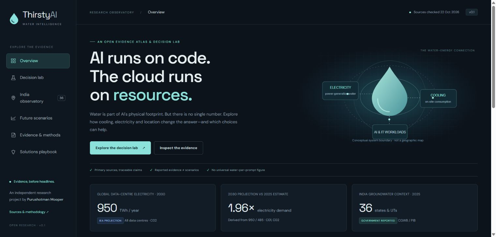
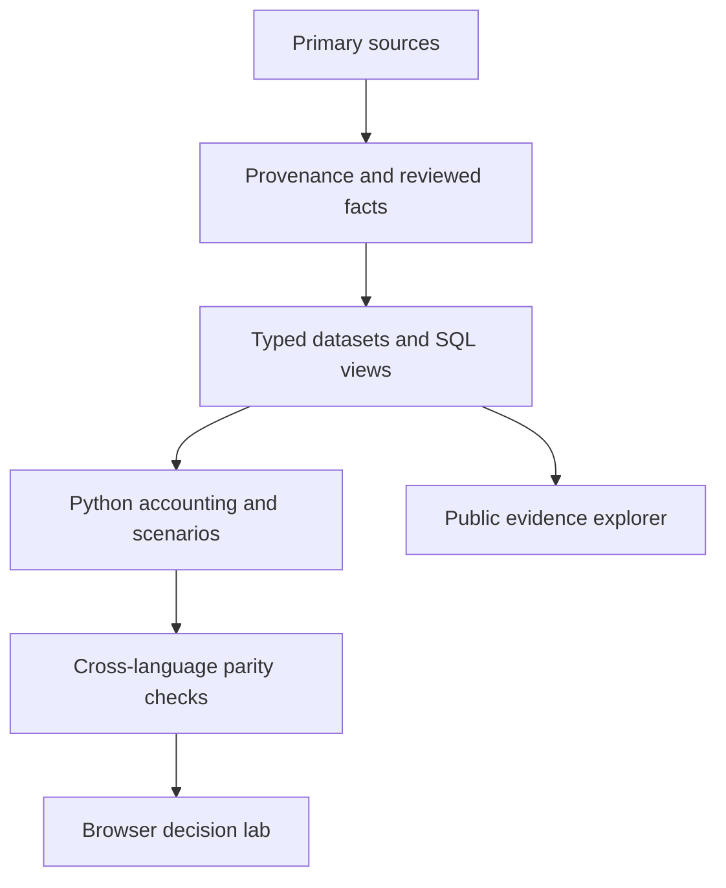

<div align="center">


# ThirstyAI
### Where AI meets water stress

**An evidence atlas and decision lab for data-centre water, cooling and energy choices.**

[**Open the live dashboard**](https://purushotmanmooper96-bit.github.io/thirstyai/) · [Explore the code](#quickstart) · [Methods](docs/methodology.md) · [Data dictionary](docs/data_dictionary.md) · [Limitations](docs/limitations.md)

</div>

AI's water footprint is not one number. A useful answer needs a workload, an energy boundary, a cooling system and a location.

ThirstyAI combines a public dashboard, auditable Python accounting, SQL views, primary-source provenance and an India groundwater study. Its central interaction holds useful IT work constant while changing water and electricity assumptions. **The sandbox inputs are illustrative, not measurements from named facilities.**



## What you can do

- **Compare** direct and electricity-related consumption alongside energy and carbon.
- **Investigate** all 36 Indian state/UT groundwater observations from the 2025 government table.
- **Explore** conditional demand and efficiency trajectories to 2035.
- **Audit** each headline's source, period, boundary, locator and caveat.
- **Export** scenario results with assumptions, India CSV and the evidence register.

## Three things the evidence supports

1. IEA's 2026 outlook estimates global data-centre electricity demand at **485 TWh in 2025** and projects **950 TWh in 2030**. This covers all data centres, not AI alone. [Source / C01–C02](https://www.iea.org/reports/key-questions-on-energy-and-ai/executive-summary).
2. India's reported national groundwater stage of extraction was **60.63% in 2025**. This is an annual flow ratio, not the percentage of groundwater storage depleted. [Source / C03 and state table](https://www.pib.gov.in/PressReleasePage.aspx?PRID=2206073&lang=1&reg=3).
3. The Google-authored serving study's **0.26 mL** result refers to its median Gemini Apps text prompt and allocated direct cooling water for May 2025. It is not a universal lifecycle footprint for an AI query. [Source / C05](https://arxiv.org/html/2508.15734v1).

**Model insight:** Lower on-site water consumption can be accompanied by higher electricity demand. Whether total operational water falls depends on both pathways. This is a conditional analytical result, not real-world water saved by this project.

## Coverage in v0.1

| Included | Scope |
|---|---|
| 6 downloaded primary sources | SHA-256 hashes, retrieval timestamps, locators, licence notes |
| 6 headline claims | Estimates, reported evidence, allocations and projections separated |
| 36 groundwater rows | One state/UT and year; all water uses |
| Python and JavaScript models | Same consumption boundary; semantic validation |
| SQL schema, seeds and views | Executed in SQLite; PostgreSQL-compatible schema supplied |
| Excel audit workbook | Editable inputs, live formulas, India data and sources |
| Power BI build pack | Power Query, DAX, theme and five-page instructions; no PBIX |

**Facility water observations: 0. Global AI water total: not estimated.** No site hotspot map or company environmental league table is inferred from incomplete inputs.

## Quickstart

The core uses Python's standard library and browser JavaScript. No API key, AI API, npm install, Docker or paid account is required. Python 3.12 and Node 22+ are recommended for the full verification suite. Runtime checks in the development environment used Python 3.12 and Node 24.

```powershell
git clone https://github.com/purushotmanmooper96-bit/thirstyai.git
Set-Location thirstyai
python scripts/reproduce.py
python -m http.server 8000 --directory dist
```

Open **http://localhost:8000**. Stop the server with Ctrl+C. For only the already-built dashboard, the HTTP server is enough; Node is needed for cross-language tests. Do not double-click `index.html`: browsers restrict local JSON/module loading over `file://`.

### Refresh sources separately

```powershell
python scripts/ingest.py --refresh
python scripts/reproduce.py
```

Refresh needs internet access and a human review of changed locators/definitions. If an anchor or the India table schema changes, the pipeline stops for review. `data/raw/` is excluded from Git. An offline rebuild uses the attributed processed snapshot; it does not pretend to re-fetch the original sources.

## How it works



```text
Facility energy = IT energy × PUE
Direct consumption = IT kWh × consumptive WUE
Electricity-related consumption = facility kWh × grid consumption factor
Operational consumption = direct + electricity-related consumption
```

The WUE denominator must be IT kWh; its numerator must be consumption and exclude indirect water. The model rejects incompatible semantics rather than silently mixing them. Water volume and local scarcity impact are separate questions. See [methodology](docs/methodology.md).

## Reproducibility and validation

`python scripts/reproduce.py` rebuilds the browser dataset, SQL seeds, SQLite database and scenario exports; runs 19 Python tests and 5 JavaScript tests; and checks SQL/Python agreement plus 30 deterministic Python/JavaScript parity cases. It also checks source/claim lineage and retained missing global totals.

Local browser QA covers shared-workload recalculation, reset, India search/threshold filtering, futures controls, evidence search and export actions. See [audit](docs/audit.md) for exact completed checks and limitations. GitHub CI passed on Windows and Linux for the first release; see the repository Actions page for the current commit.

## Project layout

- `src/thirstyai/`: Python accounting engine.
- `scripts/`: ingestion, build, database and reproduction.
- `research/`: sources, claims and retrieval provenance.
- `data/processed/`: attributed India snapshot.
- `dist/`: zero-build browser application and exported evidence.
- `sql/`: schema, seeds and analytical queries.
- `notebooks/`: reproducible analytical walkthrough.
- `excel/`: working audit workbook.
- `bi/`: Power BI build instructions and reusable query/measure files.
- `docs/`: methods, limitations, ten-topic evidence status, solutions and roadmap.
- `tests/`: semantic, mathematical and data-integrity checks.

## What happens next

Demand growth can raise total use even as individual tasks become more efficient. The future tool exposes that arithmetic without pretending to forecast every workload or technology. The solutions playbook covers cooling, energy supply, disclosure, local context, efficiency and maintenance.

The next research milestone is a **verified facility or basin case study** with compatible water, energy and supply-source evidence. Global hotspot rankings, calibrated cooling coefficients and semiconductor water allocation remain research gaps, not completed features. [Roadmap](docs/roadmap.md).

## Contributing and corrections

Open a data-correction issue with the source URL, exact locator, original value, proposed correction and relevant boundary. Improvements to source extraction, accessibility, local evidence and reproducibility are welcome. See [CONTRIBUTING](CONTRIBUTING.md). Do not contribute private data, unauthorised datasets or guessed site attributes.

## Author and citation

**Purushotman Mooper.** Independent analyst portfolio work. This project does not represent the author's former employer or endorsement by the named source organisations. See `CITATION.cff` for citation metadata.

## Licence

Original source code: [MIT](LICENSE). Source documents and underlying data retain their own terms. No blanket licence is claimed over third-party datasets; see [data licensing](docs/data_licensing.md). Facts are attributed; raw third-party documents are not redistributed.
